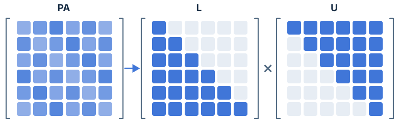
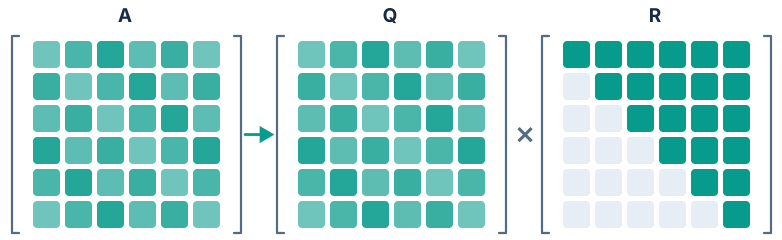
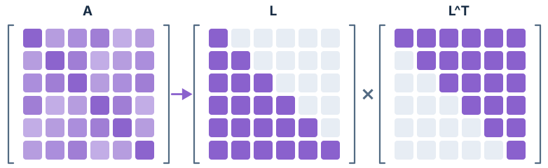
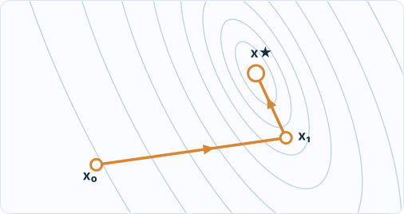
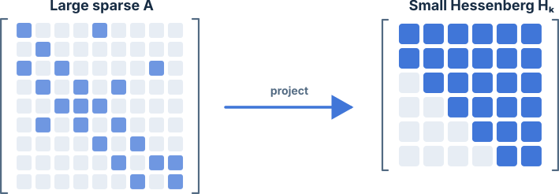
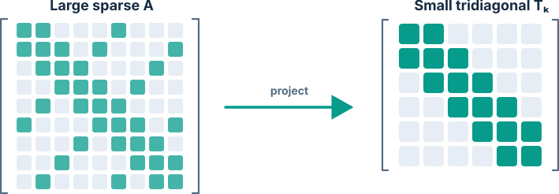

```{r}
#| label: setup
#| include: false

knitr::opts_chunk$set(collapse = TRUE, comment = "#>")
library(sanic)
```

Think of a matrix $A$ as a machine that transforms an input $x$ into an output $b$.
Solving a linear system means recovering the **unknown input** from a known output:
$$
  \underbrace{A}_{\text{function}} \underbrace{x}_{\text{input}} = \underbrace{b}_{\text{output}}.
$$

There are at least three ways of thinking about this problem:

- **Direct solvers** factor $A$ into simpler pieces (LU, QR, Cholesky).
- **Iterative solvers** refine an initial guess using repeated matrix-vector products (CG, BiCGSTAB, LSCG).
- **Spectral methods** reveal how $A$ stretches and rotates space (eigen, SVD, Arnoldi, Lanczos).

The first two families find $x$; the third characterizes $A$.

## 1. Direct solvers: matrix factorization

Triangular systems are easy to solve: find the single unknown in the first equation, then substitute it into the next. 
Direct methods work by factoring a general matrix into triangular pieces.

In the diagrams below, coloured squares show *potentially nonzero entries* and pale squares show *structural zeros*.

### LU: record elimination steps

{width=100%}

Gaussian elimination removes entries below the diagonal. 
LU factorization records these steps as $PA = LU$, where $P$ reorders rows for numerical stability.
Solving $Ax = b$ reduces to two triangular solves: $Ly = Pb$, then $Ux = y$.

Use **`solve_lu()`** for general nonsingular square matrices.
Full pivoting also permutes columns; the solver handles all permutations automatically.

### QR: build perpendicular directions

{width=100%}

In $A = QR$, the columns of $Q$ are orthonormal, i.e., perpendicular unit vectors. 
Rotating into $Q$'s coordinates preserves lengths, leaving an upper-triangular system in $R$.
Pivoted variants also reorder columns.

Use **`solve_qr()`** for square systems or rectangular least squares.
When there are more equations than unknowns, it finds the best fit by minimizing $\Vert{}Ax - b\Vert{}_2^2$. 
Full column rank guarantees a unique solution.

### Cholesky: use symmetry to halve the work

{width=100%}

A symmetric positive definite (SPD) matrix satisfies $A = A^\top$ and $z^\top Az > 0$ for every nonzero $z$.
It factors as $A = LL^\top$, where a single triangular factor serves as both halves—requiring roughly half the compute and memory of LU.

Use **`solve_chol(A, b, pivot = 0)`** for the standard $LL^\top$ form. 
By default, `solve_chol()` computes $LDL^\top$, which inserts a diagonal factor $D$.
While SPD input is the safe baseline for both, do not assume the default $LDL^\top$ can solve arbitrary indefinite or singular symmetric systems.


## 2. Iterative solvers: improve a guess

Iterative methods start with an initial guess $x_0$ and progressively update it. 
At each step, the **residual** $r_k = b - Ax_k$ measures how far the current output is from $b$.

For SPD matrices, solving $Ax = b$ is equivalent to finding the bottom of a quadratic valley:
$$
  f(x) = \tfrac12x^\top Ax - b^\top x.
$$

{width=100%}

The ellipses trace contours of equal height. 
**Conjugate gradient (CG)** steps along $A$-conjugate directions so it never undoes earlier progress, reaching this 2D minimum in two steps.
In exact arithmetic, CG converges in at most $n$ steps for an $n$-dimensional SPD system.
In practice, conditioning and roundoff govern convergence, and the residual norm may not decrease at every step.

| Call                          | Matrix type                | Mental picture                         |
| :---                          | :---                       | :---                                   |
| `solve_cg(type = "CG")`       | SPD                        | Navigate a quadratic valley            |
| `solve_cg(type = "BiCGSTAB")` | General nonsingular square | Stabilize irregular residual behaviour |
| `solve_cg(type = "LSCG")`     | Rectangular least squares  | Improve the fit using $A$ and $A^\top$ |

Despite its name, **`solve_cg()`** defaults to **BiCGSTAB** – specify `type` explicitly when you want CG or LSCG. 
Inputs are automatically converted from dense to sparse format. 
 Because each step only requires matrix-vector products, iterative solvers avoid *fill-in*, where direct factors become much denser than $A$.

A **preconditioner** reshapes the problem to speed up convergence—like rounding out a narrow, elongated valley. 
The default diagonal scaling (`precond = 1`) is a helpful baseline.
Use `tol` and `iter` to control stopping criteria; always check convergence and the final residual.


## 3. Spectral methods: find key directions

Instead of solving for a single input $x$, spectral methods ask how the machine $A$ acts on space as a whole: which directions does it stretch the most, which does it squash near zero, and which pass through unchanged? 
Answering this reveals whether $Ax = b$ is sensitive to noise, redundant, or reducible to a much smaller problem.

### Eigen and SVD: directions and stretching

An eigenvector $v$ keeps its direction when multiplied by $A$, scaled only by its eigenvalue $\lambda$:
$$
  Av = \lambda v.
$$

**`eigen2()`** computes eigenvalues and, optionally, eigenvectors.
A real symmetric matrix decomposes as $A = Q\Lambda Q^\top$, giving orthogonal eigenvectors and real eigenvalues; nonsymmetric matrices can have complex eigenpairs.

**`svd2()`** generalizes this to rectangular matrices:
$$
  A = U\Sigma V^\top.
$$

Geometrically, $A$ **rotates (or reflects), stretches, and rotates again**. 
The columns of $V$ are input directions, $\Sigma$ contains the stretch factors (singular values), and $U$ gives the output directions. 
Near-zero singular values reveal directions that $A$ nearly collapses, making inversion sensitive.
SVD is ideal for diagnosing rank, conditioning, and low-rank approximations.
Both `eigen2()` and `svd2()` take dense matrices.

### Arnoldi and Lanczos: project a large matrix onto a small one

Repeatedly multiplying a starting vector $v$ by $A$ explores a **Krylov subspace**:
$$
  \mathcal K_k(A,v) = \operatorname{span}\{v,Av,\ldots,A^{k-1}v\}.
$$

**`arnoldi()`** builds an orthonormal basis $Q$ for this subspace and projects $A$ onto a smaller upper-Hessenberg matrix with zeros below the first subdiagonal.

{width=100%}

**`lanczos()`** exploits symmetry to produce a tridiagonal projection using a shorter recurrence.
By default, `sanic` uses reorthogonalisation to keep the basis accurate.

{width=100%}

The eigenvalues of these projections approximate the most prominent parts of $A$'s spectrum rather than every eigenvalue.
Set `iter` below `nrow(A)` (the default) to build a smaller projection.
Both functions convert dense inputs to sparse format and return the projection, basis `Q`, and optional eigenvalues—not the eigenvectors of $A$.
For symmetric inputs, `arnoldi()` automatically switches to Lanczos.


## 4. Which should I try?

| Your problem | Starting point | For a large sparse problem |
| :--- | :--- | :--- |
| Square, SPD | `solve_chol()` | Consider CG |
| Square, general nonsingular | `solve_lu()` | Consider BiCGSTAB |
| Rectangular least squares | `solve_qr()` | Consider LSCG |
| Eigenvalues or eigenvectors | `eigen2()` | Consider Arnoldi or Lanczos projections |
| Singular values, rank, conditioning | `svd2()` | Dense interface only |

Treat these as starting points—size, fill-in, rank, and conditioning all matter. 
For a quick default, **`solve2()`** automatically picks a *direct* solver: QR for rectangular matrices, Cholesky for symmetric matrices (falling back to LU if needed), and LU otherwise. 


## 5. One system, several routes

Consider the SPD system

$$
  A = \begin{bmatrix} 4 & 1 \\ 1 & 3 \end{bmatrix}, 
  \qquad
  b = \begin{bmatrix} 1 \\ 2 \end{bmatrix}, 
  \qquad 
  x = \begin{bmatrix} 1/11 \\ 7/11 \end{bmatrix}.
$$

LU, QR, Cholesky, and CG all recover $x$ via different routes:

```{r}
#| label: same-system

A <- matrix(c(4, 1, 1, 3), nrow = 2)
b <- c(1, 2)
fits <- cbind(
  LU = solve_lu(A, b),
  QR = solve_qr(A, b),
  Cholesky = solve_chol(A, b),
  CG = solve_cg(sparsify(A), b, type = "CG", tol = 1e-10)
)
fits

# Check how closely each result reproduces b.
r <- A %*% fits - matrix(b, nrow = 2, ncol = ncol(fits))
sqrt(colSums(r^2)) / sqrt(sum(b^2))
```

A small relative residual is reassuring, though for ill-conditioned matrices it does not guarantee a small error in $x$.
Here, all four methods match the exact answer, `c(1, 7) / 11`.

For a rectangular example, we fit an intercept and slope to noisy observations:

```{r}
#| label: least-squares

X <- cbind(intercept = 1, time = 0:4)
y <- c(1, 2, 2, 4, 4)
cbind(
  QR = solve_qr(X, y),
  LSCG = solve_cg(sparsify(X), y, type = "LSCG", tol = 1e-10)
)
```

A nonzero residual is expected here – we want the best fit, not an exact solve. 
On a tiny problem like this, direct factorization is effortless; on a sparse matrix with millions of rows, an iterative solver shines.

**In short:** direct methods factor the matrix, iterative methods refine a guess, and spectral methods reveal the geometry. See `?solve2`, `?solve_cg`, and `?arnoldi` for full parameter details.

## Further reading

- **Trefethen, L. N., & Bau, D. (1997).** *Numerical Linear Algebra*. SIAM. — A concise, geometric introduction to QR, SVD, conditioning, and Krylov subspaces. <https://doi.org/10.1137/1.9780898719574>.
- **Shewchuk, J. R. (1994).** *An Introduction to the Conjugate Gradient Method Without the Agonizing Pain*. — A classic visual guide to quadratic valleys, contours, and conjugate directions.
- **Golub, G. H., & Van Loan, C. F. (2013).** *Matrix Computations* (4th ed.). Johns Hopkins University Press. — The standard reference for matrix factorizations and spectral algorithms.
- **Halko, N., Martinsson, P.-G., & Tropp, J. A. (2011).** *Finding Structure with Randomness: Probabilistic Algorithms for Constructing Approximate Matrix Decompositions*. SIAM Review, 53(2), 217–288. — A foundational introduction to randomized low-rank approximation and probabilistic algorithms. <https://doi.org/10.1137/090771806>.
- **Guennebaud, G., Jacob, B., et al.** *Eigen C++ Library Documentation*. — Implementation details for the C++ solvers underlying `sanic`. <https://eigen.tuxfamily.org>.
- **Qiu, Y., & Mei, J. (2026).** *RSpectra: Solvers for Large-Scale Eigenvalue and SVD Problems*. R package. — Efficient partial eigenvalue and singular value decompositions using Krylov methods. <https://CRAN.R-project.org/package=RSpectra>.
